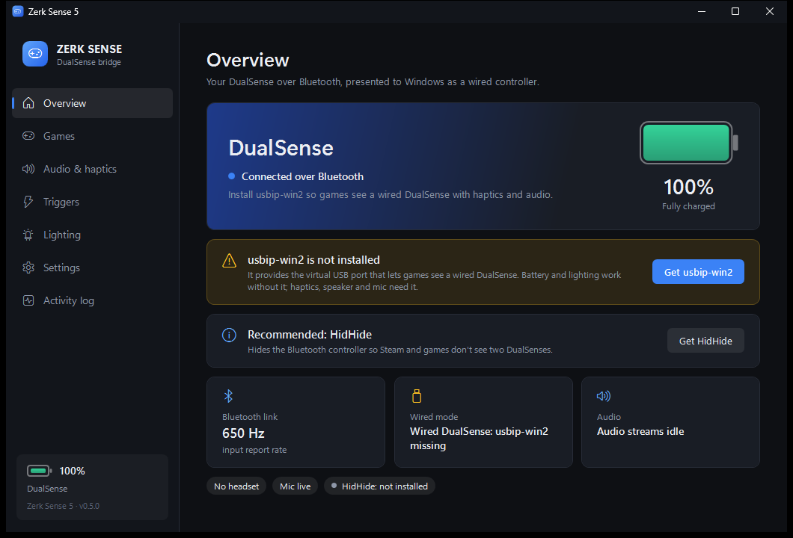
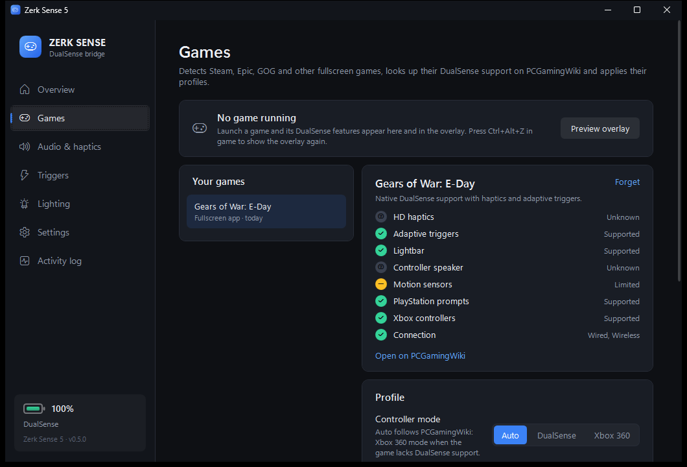
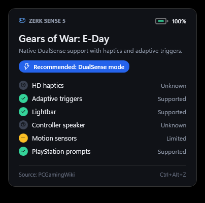
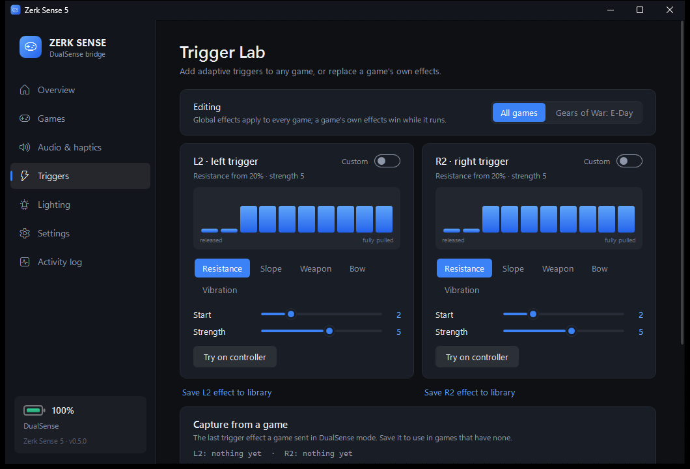
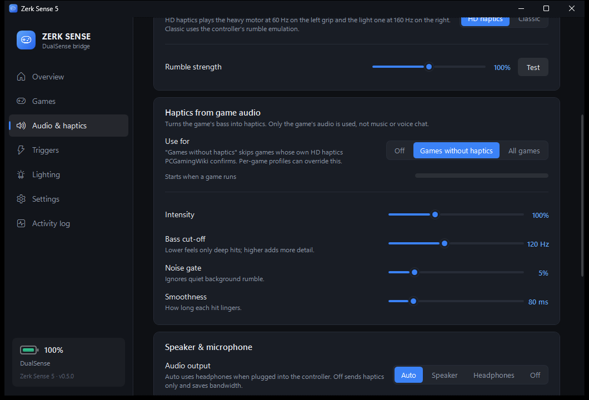

# Zerk Sense 5

Use a DualSense over plain Bluetooth on Windows and still get the features that normally need a USB cable: HD haptics, the controller speaker and microphone, and adaptive triggers in games that support them. On top of that it adds DualSense features to games that don't support the controller at all.

The idea comes from [DS5Dongle](https://github.com/awalol/DS5Dongle), which does the wired-over-wireless part with a Raspberry Pi Pico. Zerk Sense 5 does it in software, with the PC's own Bluetooth.



## How it works

The controller connects to Windows over Bluetooth as usual. Zerk Sense 5 reads it and plugs a virtual **wired** DualSense into Windows through a local USB/IP connection; [usbip-win2](https://github.com/vadimgrn/usbip-win2) provides the virtual USB port. Windows loads its normal drivers, so games see a USB DualSense with its 4-channel audio device. The app translates everything in both directions: input, output reports, the haptics audio stream, speaker audio (Opus) and the microphone.

For games without DualSense support it can plug in a virtual **Xbox 360 controller** instead, using Windows' built-in driver, and keep adding DualSense features on top of it.

## Features

- **Wired features over Bluetooth:** HD haptics, speaker, headset jack, microphone, adaptive triggers and lightbar.
- **Battery:** level and charging state in the app and in the tray icon, plus a low battery alert.
- **Game detection:** Steam, Epic, GOG and other fullscreen games. Each game's DualSense support is looked up on [PCGamingWiki](https://www.pcgamingwiki.com).
- **Overlay:** shows what the current game supports when it starts. Press Ctrl+Alt+Z to show it again.
- **Per-game profiles:** controller mode, haptics and trigger strength, lightbar colour, audio haptics and trigger effects.
- **Xbox 360 mode:** for games without DualSense support. Rumble plays as HD haptics or classic rumble, and the player number shows on the touchpad LEDs.
- **Haptics from game audio:** the game's bass drives the grips in games without their own haptics. Only the game's audio is captured, not music or voice chat.
- **Trigger Lab:** build trigger effects, record the effects a game sends and replay them in other games.
- **Lightbar effects:** breathing, rainbow, battery level and audio reactive.

## Screenshots

| Games | Overlay |
|---|---|
|  |  |

| Trigger Lab | Haptics from game audio |
|---|---|
|  |  |


## Requirements

- Windows 10 version 2004 or later, or Windows 11 (x64)
- [.NET 8 Desktop Runtime](https://dotnet.microsoft.com/download/dotnet/8.0)
- A Bluetooth adapter
- [usbip-win2](https://github.com/vadimgrn/usbip-win2/releases) for wired mode, Xbox 360 mode, haptics and audio. Battery, lighting and settings work without it.
- [HidHide](https://github.com/nefarius/HidHide/releases), optional but recommended. It hides the Bluetooth controller so games only see the virtual one.

## Getting started

1. Install usbip-win2 and, if you want it, HidHide.
2. Pair the DualSense in Windows Bluetooth settings: hold PS and Create until the light flashes.
3. Run `ZerkSense5.exe`. It asks for administrator rights because `usbip attach` and HidHide need them.

The virtual controller is plugged in when the DualSense connects and removed when it disconnects. Closing the window keeps the app running in the tray. Use the tray menu to exit.

## Building

```
dotnet build -c Release
```

The output goes to `bin/Release/net8.0-windows`. The only package dependency is [Concentus](https://github.com/lostromb/concentus) for Opus.

## Diagnostics

These run without the GUI. Use `dotnet ZerkSense5.dll` to skip the admin prompt.

| Command | What it does |
|---|---|
| `--selftest` | Drives the virtual devices with a built-in USB/IP client and a simulated controller |
| `--probe` | Talks to the paired controller: feature reports, input rate, a lightbar change and a short haptics buzz |
| `--games [appid:name or title ...]` | Runs the PCGamingWiki lookup for installed Steam and Epic games, or for the given ones |
| `--capture [pid]` | Records 3 seconds of a process's audio, or all system audio, through the audio haptics filter |

## Settings

Everything is editable in the app and saved to `config.json` next to the executable. Per-game profiles are stored in the same file. PCGamingWiki results are cached in `%LOCALAPPDATA%\ZerkSense5`.

## Known limitations

- The overlay doesn't appear over games running in exclusive fullscreen.
- A DualSense Edge is presented as a regular DualSense.
- Audio quality depends on the Bluetooth adapter. If the speaker stutters, switch the packet mode to Single or raise the audio buffer.
- Switching between DualSense and Xbox 360 mode while a game is running relies on the game handling controller hotplug.

## Credits

- [DS5Dongle](https://github.com/awalol/DS5Dongle) by awalol for the Bluetooth and USB protocol details
- [GP2040-CE](https://github.com/OpenStickCommunity/GP2040-CE) for the Xbox 360 USB descriptors
- [Concentus](https://github.com/lostromb/concentus) for Opus encoding and decoding
- [PCGamingWiki](https://www.pcgamingwiki.com) for game controller data
- [usbip-win2](https://github.com/vadimgrn/usbip-win2) and [HidHide](https://github.com/nefarius/HidHide)

See [THIRD_PARTY_NOTICES.md](THIRD_PARTY_NOTICES.md) for their licenses.

## License

[MIT](LICENSE)
