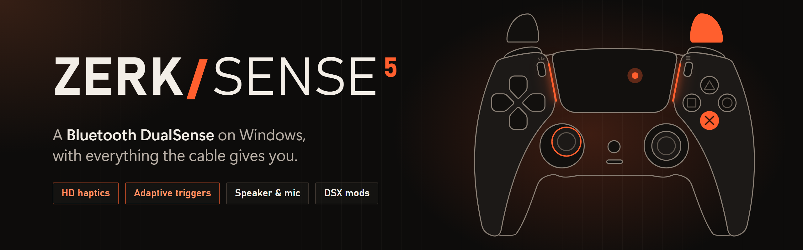
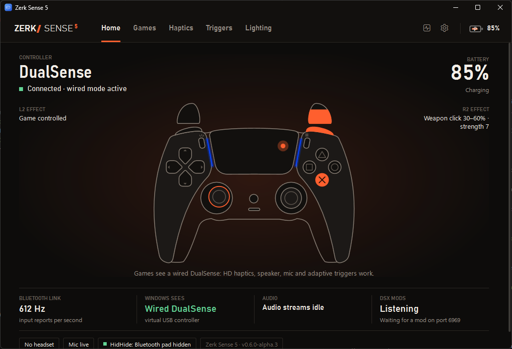
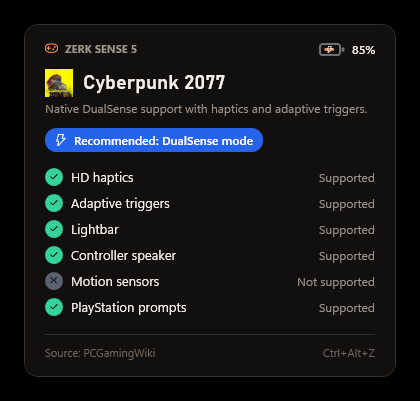
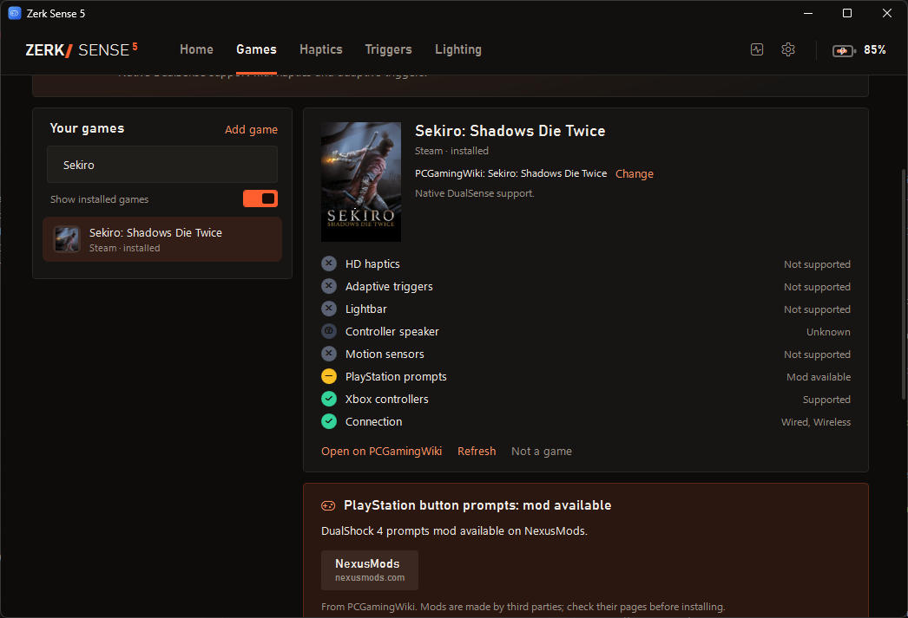
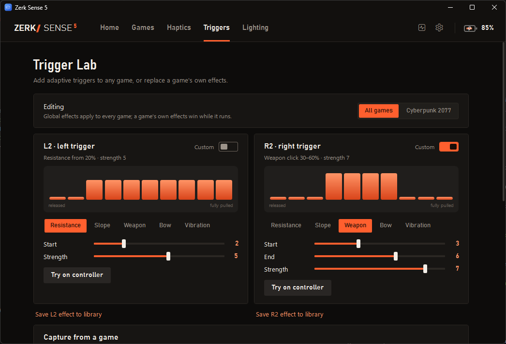
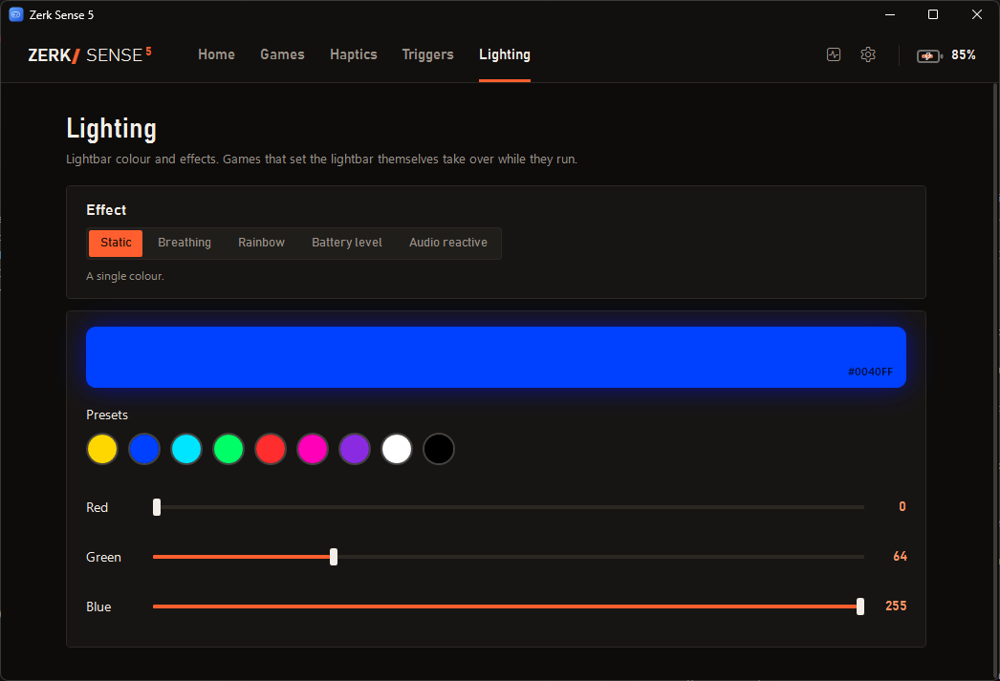

<p align="center">
  
</p>

<p align="center">
  <a href="https://github.com/florinp93/ZerkSense5/releases">
    
  </a>
  <a href="https://ko-fi.com/zerkiller">
    
  </a>
  <a href="https://github.com/florinp93">
    
  </a>
</p>

> **AI use.** Since v0.7.0-alpha.1, AI (Claude) is used for testing, such as writing the latency and jitter test, and for documentation. Everything it produces is reviewed by me before it goes public. Co-Author will be visible to any commits that have used AI. 

Use a DualSense over plain Bluetooth on Windows and still get the features that normally need a USB cable: HD haptics, the controller speaker and microphone, and adaptive triggers in games that support them. On top of that it adds DualSense features to games that don't support the controller at all.

The idea comes from [DS5Dongle](https://github.com/awalol/DS5Dongle), which does the wired-over-wireless part with a Raspberry Pi Pico. Zerk Sense 5 does it in software, with the PC's own Bluetooth.

> **Alpha.** This is an early pre-release. Expect rough edges, and please [open an issue](https://github.com/florinp93/ZerkSense5/issues) when something doesn't work.



## How it works

The controller connects to Windows over Bluetooth as usual. Zerk Sense 5 reads it and plugs a virtual **wired** DualSense into Windows through a local USB/IP connection; [usbip-win2](https://github.com/vadimgrn/usbip-win2) provides the virtual USB port. Windows loads its normal drivers, so games see a USB DualSense with its 4-channel audio device. The app translates everything in both directions: input, output reports, the haptics audio stream, speaker audio (Opus) and the microphone.

For games without DualSense support it can plug in a virtual **Xbox 360 controller** instead, using Windows' built-in driver, and keep adding DualSense features on top of it.

## Features

- **Wired features over Bluetooth:** HD haptics, speaker, headset jack, microphone, adaptive triggers and lightbar.
- **Live controller view:** the Home page draws the DualSense and lights up buttons, sticks, triggers, touchpad and lightbar as you use it, next to the trigger effects in use.
- **DSX mods:** game mods made for DSX drive the adaptive triggers and lights without DSX installed. See [DSX mods](#dsx-mods).
- **Battery:** level and charging state in the app and in the tray icon, plus a low battery alert.
- **Game library:** installed games from Steam, Epic, GOG, Ubisoft Connect, Xbox, EA and Battle.net, plus every game inside your game folders (any `Games` folder on a drive is picked up automatically). Each game gets its own icon, and Steam games their cover art.
- **Game detection:** the running game is found by its install folder, Steam's running-game status, or as a fullscreen 3D app. Helpers like crash reporters and anti-cheat launchers are ignored.
- **PCGamingWiki matching:** each game's DualSense support is looked up on [PCGamingWiki](https://www.pcgamingwiki.com). Games outside a launcher are matched using their installer entry, Steam or GOG files, folder name and window title, with release-style names cleaned up first. A wrong or missing match can be fixed by searching PCGamingWiki from the game's page.
- **Overlay:** shows what the current game supports when it starts. Press Ctrl+Alt+Z to show it again.
- **PlayStation button prompt mods:** when PCGamingWiki lists a mod that adds PlayStation prompts, the game's page shows the steps and links, and the overlay mentions it.
- **Per-game profiles:** controller mode, haptics and trigger strength, lightbar colour, audio haptics and trigger effects.
- **Xbox 360 mode:** for games without DualSense support. Rumble plays as HD haptics or classic rumble, and the player number shows on the touchpad LEDs.
- **Haptics from game audio:** the game's bass drives the grips in games without their own haptics. Only the game's audio is captured, not music or voice chat.
- **Trigger Lab:** build trigger effects, record the effects a game sends and replay them in other games.
- **Lightbar effects:** breathing, rainbow, battery level and audio reactive.
- **Guided setup:** if usbip-win2 or HidHide is missing, the app offers to download the official installer from GitHub, checks it, and runs it.
- **Automatic updates:** new releases are found on GitHub; one click downloads, verifies and installs them.

## Screenshots

| Games | Overlay |
|---|---|
|  |  |

| PlayStation prompt mods | Trigger Lab |
|---|---|
|  |  |

| Haptics from game audio | Lighting |
|---|---|
|  |  |

The screenshots use the built-in showcase mode (`ZerkSense5.exe --demo`) with sample games.

## Requirements

- Windows 10 version 2004 or later, or Windows 11 (x64)
- A Bluetooth adapter
- For the framework-dependent download only: [.NET 8 Desktop Runtime](https://dotnet.microsoft.com/download/dotnet/8.0)
- [usbip-win2](https://github.com/vadimgrn/usbip-win2/releases) for wired mode, Xbox 360 mode, haptics and audio. Battery, lighting and settings work without it.
- [HidHide](https://github.com/nefarius/HidHide/releases), optional but recommended. It hides the Bluetooth controller so games only see the virtual one.

## Getting started

1. Download the latest release from the [Releases page](https://github.com/florinp93/ZerkSense5/releases). `ZerkSense5-<version>-win-x64.zip` is self-contained; the `-framework-dependent` zip is smaller but needs the .NET 8 Desktop Runtime.
2. Unzip it anywhere and run `ZerkSense5.exe`. It asks for administrator rights because `usbip attach` and HidHide need them.
3. Let it install usbip-win2 and HidHide when it asks (restart Windows after HidHide).
4. Pair the DualSense in Windows Bluetooth settings: hold PS and Create until the light flashes.

The virtual controller is plugged in when the DualSense connects and removed when it disconnects or is switched off. Closing the window keeps the app running in the tray. Use the tray menu to exit.

## DSX mods

Many games get adaptive triggers and lighting from mods written for [DSX](https://github.com/Paliverse/DualSenseX). Those mods send their effects to DSX over a local connection. Zerk Sense 5 listens for the same messages, so the mods work without DSX.

1. Close DSX if it's installed. Both apps use port 6969, and only one can listen on it.
2. In Zerk Sense 5, check that **DSX mods** is on (Triggers page). It's on by default.
3. Install the mod as its page describes, but skip installing or starting DSX.
4. Start the game. The Home page shows **DSX mods: Active** once the mod connects.

Notes:

- Mods work in both DualSense and Xbox 360 mode. Most DSX mods are for games without DualSense support, which Auto runs in Xbox 360 mode.
- A mod's trigger effects take priority over the game profile's custom effects and over rumble on the triggers. They are cleared when the game closes.
- Supported: trigger effects (including custom values), lightbar colour, player LEDs, mic LED and reset to user settings. The reply mods wait for includes the real battery level.
- Mods written for the newer DSX v3 protocol only aren't supported yet.
- Mods that talk to the controller themselves instead of through DSX don't need this. They see the virtual wired DualSense in DualSense mode, as they would a USB-connected controller.

## Latency and jitter

Bridging adds about **0.04 ms** of input latency, and no jitter of its own.

| Mode | Reports measured | Median | p95 | p99 | Dropped reports |
|---|---|---|---|---|---|
| DualSense | 18,319 | 37 µs | 48 µs | 62 µs | 0 |
| Xbox 360 | 19,097 | 35 µs | 45 µs | 59 µs | 0 |

The controller sent about 800 reports a second, one every 1.25 ms. Most reports arrived on time, but about 1 in 100 came after a gap of 11 to 15 ms, occasionally up to 25 ms. Those gaps were already there in the controller's own timestamps and on arrival over Bluetooth, before the bridge. The virtual controller passed them through unchanged: the spread of report intervals was the same going in and coming out (standard deviation 2,176 µs in, 2,175 µs out in DualSense mode). A game reading the DualSense directly over Bluetooth would see the same gaps.

**How it was measured.** One DualSense over Bluetooth, 30 seconds per mode, with the built-in `--latency` diagnostic. Every Bluetooth report was timestamped as it reached the app, which is when a game reading the controller directly over Bluetooth would get it. The same report was timestamped again when it came out of the virtual controller:

- **DualSense mode:** read from the virtual wired DualSense as a HID device, the way games read it. Reports were paired by the controller's packet number and timestamp, which pass through unchanged.
- **Xbox 360 mode:** read through XInput, checked continuously while the sticks moved. Each change was paired with the latest Bluetooth report that produced the same buttons, triggers and stick positions.

Both timestamps come from the same high-resolution clock. The time from pressing a button to the report reaching Windows is the same with or without the bridge, so it isn't part of the measurement. To measure your own setup, see `--latency` under [Diagnostics](#diagnostics).

## Building

```
dotnet build -c Release
```

The output goes to `bin/Release/net8.0-windows`. Release packages are made with:

```
dotnet publish -c Release -r win-x64 --self-contained true -p:PublishSingleFile=true -p:IncludeNativeLibrariesForSelfExtract=true
dotnet publish -c Release -r win-x64 --self-contained false
```

Versions follow [Semantic Versioning](https://semver.org); pre-releases are tagged like `v0.6.0-alpha.1`. See [CHANGELOG.md](CHANGELOG.md). The only package dependency is [Concentus](https://github.com/lostromb/concentus) for Opus.

## Diagnostics

These run without the GUI. Use `dotnet ZerkSense5.dll` to skip the admin prompt.

| Command | What it does |
|---|---|
| `--selftest` | Drives the virtual devices with a built-in USB/IP client and a simulated controller |
| `--probe` | Talks to the paired controller: feature reports, input rate, a lightbar change and a short haptics buzz |
| `--games [appid:name or title ...]` | Runs the PCGamingWiki lookup for every game in the library, or for the given ones |
| `--capture [pid]` | Records 3 seconds of a process's audio, or all system audio, through the audio haptics filter |
| `--latency [seconds] [--xbox]` | Measures the latency and jitter the bridge adds, in DualSense or Xbox 360 mode. Needs an admin terminal and the app closed; saves a report next to the executable |

## Settings

Everything is editable in the app and saved to `config.json` next to the executable. Per-game profiles are stored in the same file. PCGamingWiki results are cached in `%LOCALAPPDATA%\ZerkSense5`.

## Known limitations

- The overlay doesn't appear over games running in exclusive fullscreen.
- PCGamingWiki's cover images can't be downloaded by the app, so covers are shown for Steam games only.
- A DualSense Edge is presented as a regular DualSense.
- Audio quality depends on the Bluetooth adapter. If the speaker stutters, switch the packet mode to Single or raise the audio buffer.
- Switching between DualSense and Xbox 360 mode while a game is running relies on the game handling controller hotplug.

## Credits

- [DS5Dongle](https://github.com/awalol/DS5Dongle) by awalol for the Bluetooth and USB protocol details
- [GP2040-CE](https://github.com/OpenStickCommunity/GP2040-CE) for the Xbox 360 USB descriptors
- [Concentus](https://github.com/lostromb/concentus) for Opus encoding and decoding
- [dualsense-tester](https://github.com/daidr/dualsense-tester) by daidr for the controller artwork
- [PCGamingWiki](https://www.pcgamingwiki.com) for game controller data
- [usbip-win2](https://github.com/vadimgrn/usbip-win2) and [HidHide](https://github.com/nefarius/HidHide)

See [THIRD_PARTY_NOTICES.md](THIRD_PARTY_NOTICES.md) for their licenses.

## License

[MIT](LICENSE)
